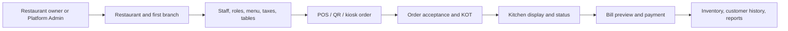

# Tablevora — product, design, engineering, and launch handoff

**Snapshot date:** 10 November 2026 (Asia/Karachi)
**Repository:** [M-FaizanAli/tablevora](https://github.com/M-FaizanAli/tablevora)
**Working directory:** `/Users/faizan/Documents/projects/resturant-pos`
**Current working branch at this snapshot:** `codex/tablevora-launch` (`020e658`)
**Audience:** another AI or developer continuing the project with no access to the earlier conversation.

> This is a point-in-time map, not a claim that every listed feature is production-verified. Before changing code, read `AGENTS.md` and `ISSUES-REPORT.md`, then inspect the current branch, source, tests, deployment, and provider terms. Do not copy historical status claims into marketing without checking current code and the live flow.

## 1. The idea and business goal

Tablevora is Faizan's branded customization of the open-source **Nodedr OrderRestro** restaurant POS and management system. The goal is to sell **setup, workflow customization, installation, training, and support** to restaurants and cafés. It can run on a local restaurant network or in a hosted environment. The public demo is a sample workspace; the intended future client SaaS has a separate Platform Admin console and tenant approval flow.

Tagline: **“A calmer service. A smarter restaurant.”** The core promise is to connect the front desk, tables, kitchen, billing, and owner reporting in one workflow. This is a proposed customer benefit, not a measured reduction in labor or errors. Do not claim customers, revenue, certifications, tax compliance, or quantified savings that have not been established.

The original authors retain copyright in their work. `LICENSE` is **AGPL-3.0-only** and `NOTICE` preserves attribution. Tablevora may be sold as a customization/service, but neither the code nor marketing should claim Faizan wrote the entire upstream application. For modified network deployments, preserve a prominent source offer for the corresponding deployed version; see [AGPL section 13](https://www.gnu.org/licenses/agpl-3.0.en.html#section13). The brand name has had only an informal web screen, not formal trademark clearance. No domain purchase is recorded.

**User constraints and decisions:**

- Use **free resources only** in the user's accounts. Never create, upgrade, or buy a paid plan/server/database, enable paid auto-recharge, or incur a charge without a new explicit instruction.
- Keep public demo and real client data completely separate. Demo content must remain fictional.
- The owner wants to market to independent restaurants/cafés, including in the **UAE and Pakistan**. No prospects have been contacted by an AI.
- Public business inquiry channel chosen by the owner: WhatsApp **+92 306 6493090**. The CTA is prepared on the separate sales branch, not deployed from the current working branch.
- One Platform Admin identity in v1, separate from restaurant staff; owner self-signups await approval. No impersonation or access to a tenant's orders/customers from Platform Admin.

## 2. Who it is for

| Segment | Likely workflow to demonstrate | Qualification questions |
| --- | --- | --- |
| Independent dine-in restaurants | Table → order → kitchen ticket → bill → daily report | How do staff relay changes to the kitchen? What printers and payment methods are used? |
| Cafés and coffee shops | Fast counter orders, modifiers, pickup, stock | How many peak-hour orders and terminals? Are recipes/ingredient counts important? |
| Takeaway and delivery operators | Order acceptance, kitchen state, delivery zone/status | Which channels create orders? Is a third-party platform already the source of truth? |
| Small multi-branch groups | Staff permissions, branch data, consolidated views | Shared menu? Per-branch taxes/prices? Central reporting or local autonomy? |
| Self-service venues | Browser kiosk and QR table ordering | Device, network, printer, language, and payment hardware requirements? |

Start with discovery and a **one-location pilot**. A business appearing on a lead list is not evidence that it needs a new POS. UAE and Pakistan currency/tax support must be validated before offering a real installation in either market. Do not present a tax suggestion as legal advice.

## 3. How the app works



1. **Onboarding:** On a production-mode service, owner self-signup creates a `PENDING` restaurant and owner, with no active tenant session. Platform Admin can approve or decline it. Platform Admin can also create the restaurant and issue a one-time owner password-setup link. Existing restaurants were migrated to `ACTIVE` by the tenant-lifecycle migration.
2. **Configuration:** The owner defines branches, staff/roles, menu categories/items/modifiers, tables, tax mode/rate, and optional printers/integrations. The browser signs in using a tenant session cookie. Access is checked server-side by permissions and tenant lifecycle status.
3. **Service:** Staff create dine-in, takeaway, or delivery orders. Orders may be accepted/declined separately from kitchen progress and billing. KOTs route items to kitchen stations. Socket.IO pushes updates; clients refetch authoritative state after an event or reconnect.
4. **Settlement:** The backend computes bill preview, discount, tax, tip, and payments; frontend totals are previews. Cash/card/other tender recording and partial settlement exist. Manual UPI QR is possible for configured Indian accounts, but there is no automatic gateway confirmation. Printing a bill is read-only; payment is an explicit step.
5. **After payment:** Inventory can deduct recipe ingredients; customer history, accounting summaries, and reports update. Realtime clients see table/order/KDS changes. Cancellation/refund paths keep audit/history rather than hard deleting transactions.
6. **Guest entry points:** `/order/[qrToken]` provides table QR ordering and requests; `/kiosk/[token]` is a browser kiosk with a token-gated menu and unpaid order submission. Kiosk hardware, silent printing, and true offline submission are not verified/implemented as general capabilities.

Relevant code: `apps/backend/src/modules/`, `apps/backend/src/auth/`, `apps/backend/src/realtime/`, `apps/backend/prisma/schema.prisma`, `apps/web/app/`, `packages/types/src/`. `ARCHITECTURE.md` documents order state machines and money rules in more detail.

## 4. Product and visual design

**Current Tablevora brand** (source: `docs/brand/README.md`, `apps/web/app/globals.css`):

| Use | Color |
| --- | --- |
| Forest hero/logo | `#123E32` |
| Primary actions/links | `#17634B` |
| Cream page | `#F7F5EF` |
| Mint on dark surfaces | `#A9E8C8` |
| Dark ink | `#182D26` |
| Card/border | `#FFFFFF` / `#DDE4DA` |

Headings use **Outfit**; interface text uses **Geist**; numbers/code can use **Geist Mono**. The app has a separate dark token set. The master logo is `apps/web/public/brand-mark.svg`; icons/favicon derive from it. `apps/web/public/brand-lockup.png` is the README lockup. The current mark was introduced to remove white padding from an earlier raster logo.

The public landing page is in `apps/web/app/page.tsx`; the login, signup, Platform Admin, dashboard, POS, KDS, tables, menu, settings, and kiosk have distinct surfaces. The authenticated shell uses a sidebar and responsive mobile navigation. POS favors speed/touch targets; KDS favors legible status and timers; kiosk forces a light palette and larger controls. `apps/web/app/globals.css` is the **current** token source, not the original `DESIGN_SYSTEM.md` (which still shows the old burgundy palette). Use shared UI components in `apps/web/components/ui/` and preserve accessible labels, focus states, adequate contrast, and keyboard/touch behavior.

Visual bugs fixed in October include logo whitespace, dashboard shell spacing, POS card widths, table hover clipping, menu photo fallback/edit, menu text overflow, and narrow-screen layout. These fixes are described in `TABLEVORA-RELEASE.md`; they need fresh screenshot checks after substantial UI changes. Check at roughly 390 px phone, 768–1024 px tablet/laptop, and desktop widths, including long item names, empty/loading/error states, dialogs, and dark mode. The demo uses generated sample food imagery; client images take precedence.

## 5. Architecture and repository map

| Layer | Current implementation |
| --- | --- |
| Workspace | pnpm 11 + Turborepo; Node >=22 |
| Web | Next.js 16 App Router, React 19, Tailwind 4, shadcn/Base UI primitives, TanStack Query, React Hook Form, Zod |
| API | NestJS 11 TypeScript, versioned REST under `/api/v1`, Socket.IO, permission guards |
| Database | PostgreSQL + Prisma 6; one schema for single or multi-branch. SQLite is not supported. |
| Shared contracts | `packages/types`: TypeScript types and Zod schemas. Build this package before API/web. |
| Browser-to-API | Next rewrites `/api/*` and `/socket.io/*` to `BACKEND_URL`, keeping tenant cookies first-party. `BACKEND_URL` is baked at web build time. |
| Portable deployment | Docker Compose: PostgreSQL, API, web; optional updater. The database and API are not exposed directly by the main Compose file. |

Primary directories: `apps/backend`, `apps/web`, `packages/types`, `docs`, `.github/workflows`, `windows/msix`, `casaos`. The Prisma schema is large and spans tenants, users/RBAC, menu, tables, orders, KOT, payments, stock, customers, workforce, accounting, campaigns, webhooks, and Platform Admin. Do not infer a fully finished UI from the presence of a model.

**Auth and tenancy:** tenant staff use JWT in an httpOnly cookie, RBAC permissions, and branch/restaurant checks. Platform Admin uses a **different identity table and cookie** (`tablevora_platform_session`), bootstrap secret, TOTP MFA, audit events, and server-side recovery command. The tenant lifecycle is `PENDING → ACTIVE` or `DECLINED`; `ACTIVE ↔ READ_ONLY`. Pending/declined tenants cannot sign in. Read-only tenants may read but should be blocked from REST/realtime/public writes. Check every new write channel, including API keys and background jobs, for lifecycle enforcement. Keep one API replica initially; multi-replica realtime fan-out and shared global throttling are not implemented.

## 6. Feature status (code exists ≠ verified in production)

| Area | Current code status and important limit |
| --- | --- |
| POS, orders, KDS, tables | Implemented, including modifiers, KOT station routing, acceptance/kitchen/billing states, partial/multi-tender recording, refunds, table and status views. Recheck live end to end. |
| Menu, inventory, procurement | Items/photos, ingredients/recipes, FIFO stock consumption, purchase orders/receipts, quotations, invoices, and transfers exist. Real client inventory opening balances and hardware still need validation. |
| Customer/operations | Customer history, loyalty/gift cards, reservations/waitlist, staff attendance/shifts/payroll, maintenance/documents exist. Payroll does not include statutory deductions for every jurisdiction. |
| Delivery and ordering | QR table ordering, kiosk, delivery zones/status, scheduled orders, and integration API exist. No native delivery-platform connector or live driver GPS. |
| Reporting/finance | Reports/export, expenses, cash closing, management P&L/balance snapshot, budgets, reconciliation exist. Do not market as a certified statutory accounting system. |
| Campaigns/integrations | Coupons/promotions, email with configured SMTP, webhook-based SMS/WhatsApp, signed outbound webhooks, API keys/MCP surfaces exist. External providers and actual mailbox delivery need configuration/testing. |
| Payments/hardware | Payment *recording*, UPI QR, browser printing, Linux USB/network thermal paths exist. No automatic gateway settlement confirmation. Physical printer, scanner, cash drawer, and Android kiosk paths remain hardware-validation work. |
| Platform Admin | Code for one operator, MFA/bootstrap/recovery, tenant list/status, direct creation/invite exists in repository. It is **disabled on the public demo** and a separate production-mode service has **not** been deployed. |
| Currency/tax | Regional signup and branch tax/currency settings exist on `codex/tablevora-launch`. Only currencies compatible with **two decimal monetary calculations** are selectable; full zero/three/four-decimal currency support is unfinished. Tax presets are suggestions, not legal compliance. |

`ROADMAP.md` is more detailed for Phase 5–8 work, but some early checkboxes/prose are stale. `FEATURE-CHECKLIST.md` and `PROJECT.md` were written earlier and contain obsolete statements (for example, some modules called “planned” there are now implemented). Verify against code and the latest release notes before copying status.

## 7. Regionalization work in progress

The working branch adds country, currency, timezone, tax regime, inclusive/exclusive mode, tax label/ID, and branch default rate to signup and Platform Admin creation. Country suggests a currency and tax system; the operator must confirm the actual rate. Presets include India GST, US sales tax, EU VAT, Spain IVA, and a custom regime; Pakistan currently maps to **custom** with a suggested sales-tax label, not an encoded national rate. A branch default applies to newly created menu items; it does not rewrite existing items or historical order snapshots. Changing restaurant currency after financial/menu data exists is restricted because relabeling amounts would not convert them.

Current branch commits: `b4a3c86` regional signup, `6140218` receipt formatting/precision plan, `020e658` widened money columns and partial checkout precision parameterization. **Do not deploy this branch as “all currencies supported.”** `packages/types/src/region.ts` filters selectable currencies to two minor units (with a PKR handling override). A migration widened many columns to four decimals, but checkout, inventory, accounting, payroll, gift cards, refunds, and other money paths still require a consistent per-restaurant precision implementation and tests. Validate at least PKR, AED, USD, INR and, before enabling them, JPY (0), KWD (3), and a four-decimal currency. Test stored totals, partial payments, refunds, receipts, reports, and concurrent tenants with different currencies. No country-wide automatic tax-rate table should be invented.

## 8. Branches, deployments, and operational state

| Ref | Status at snapshot |
| --- | --- |
| `origin/master` | `58d28d6`, the stable repository line associated with the existing public demo. Local `master` is behind remote and should not be treated as current. |
| `codex/tablevora-launch` | `020e658`, current working branch with **unfinished** regional currency work. Not confirmed deployed. |
| `codex/tablevora-sales` | `fcd3342`, separate branch based on `origin/master` with WhatsApp sales CTA and an updated `docs/LAUNCH-PLAN.md`. Pushed to GitHub; **not deployed or merged**. |

Public sample URL: [tablevora.vercel.app](https://tablevora.vercel.app/). Demo login: `owner@demo.local` / `Password123!` — use fictional data only. Existing demo architecture: Vercel frontend, Render Free API `tablevora-api.onrender.com`, Neon Free PostgreSQL. `render.yaml` sets `DEMO_MODE=true`, `TENANT_SIGNUP_ENABLED=false`, `PLATFORM_ADMIN_ENABLED=false`, and `SEED_DEMO=false`; `docs/deployment.md` documents the setup and `.github/workflows/demo-health.yml` schedules a best-effort API check. This is **not** a client production environment. Do not point a real tenant at its database or publish the demo credentials on a real client service.

**Live check on 10 November 2026:** landing and login returned HTTP 200; the proxied `/api/health` timed out after 20 seconds in the most recent check. An earlier same-day check returned health 200 and a demo login request succeeded. The complete order-to-kitchen-to-payment-to-report flow has **not** been reverified after these checks. Treat demo availability as intermittent until diagnosed; a health endpoint does not test PostgreSQL or business operations.

**Free-only hosting constraint:** [Vercel Hobby terms](https://vercel.com/legal/terms) limit use to personal/noncommercial purposes. [Render Free docs](https://render.com/docs/free) say free instances are for preview, not production, and document idle spin-down/ephemeral storage. The current public Vercel/Render demo must not be assumed suitable for a commercial sales site or real client production. [Netlify says its Free plan permits commercial projects](https://www.netlify.com/blog/introducing-netlify-free-plan/) and its [current Free plan has a hard credit limit](https://docs.netlify.com/manage/accounts-and-billing/billing/billing-for-credit-based-plans/credit-based-pricing-plans/); it is a **candidate** for the sales frontend, not a verified deployed replacement. The owner has not provided an authenticated Netlify deployment session in this work. Verify current plan terms and Next.js proxy behavior before deploying. Do not buy or enable paid resources.

Untracked local `brag-output/` and motion-video files are unrelated user/work artifacts; do not overwrite/delete them. The existing promo video contains outdated menu/currency and “zero subscription fees” claims; review and correct it before publication.

## 9. Launch answer: what can go live, and when

| Stage | Earliest responsible release condition | Current blocker |
| --- | --- | --- |
| **Public marketing site** | Deploy the sales branch to a free host that permits commercial use; verify source/credits, WhatsApp link, mobile layout, HTTPS, and actual destination. Could be days after hosting access is available; no date is committed. | Sales CTA is not deployed; suitable host access and deployment QA remain. |
| **Guided sample demo** | Restore reliable API/database availability and run full sign-in → order/modifier → KDS → bill/payment → report → logout checks using fictional data. Explain free-host cold starts. | Latest API health timeout; full current live flow unverified. |
| **First real restaurant pilot** | Use a separate installation/database and client-owned suitable infrastructure or on-prem server; agree scope, country-specific tax/currency, printers, backup/restore, staff permissions, training, rollback, and acceptance. | No verified client environment, hardware, or regional acceptance. Do not run it on the public demo. |
| **Public multi-tenant SaaS** | Provision isolated production-mode API/DB/frontend; apply migrations; bootstrap Platform Admin/MFA; test signup, approval, decline, read-only, tenant isolation, public/realtime write denial, backup/restore, observability, and capacity. | Production service absent; current free-only hosting options are not a reliable production plan; currency work and platform E2E coverage remain. No credible fixed launch date. |

For marketing, be explicit that Tablevora is a customized AGPL project. Lead with a short order-to-kitchen walkthrough and offer a scoped paid service pilot; do not imply a production SaaS is already live. Previous public-prospect research found candidate restaurants in the UAE and Pakistan (for example Habun, Another One, Wejdan, 93 Brew, Frostbury, Ziafat), but no interest, decision maker, or purchase intent has been confirmed. Outreach was **not** sent.

## 10. Ordered work left

### P0 — before sharing or accepting live client data

1. Diagnose the intermittent public API timeout; check Render/Neon health, deployment revision, proxy path, free quotas, and cold-start behavior. Run the complete hosted demo flow and log results.
2. Keep the sales branch separate from unfinished currency changes; deploy to an eligible **free commercial** host only after access is available, then verify the CTA, `/about` source/credit link, mobile layout, and live demo link. No paid upgrade.
3. Finish and verify regional money precision **or explicitly limit** client onboarding to tested two-decimal currencies and jurisdiction-specific configurations. Do not offer automatic tax compliance.
4. Add real database-backed integration tests for Platform Admin bootstrap, MFA/lockout/recovery/logout, invite and owner setup, signup approval/decline, READ_ONLY denial across REST, API keys, sockets, QR/kiosk/public ordering, and cross-tenant isolation. Unit tests alone are insufficient.
5. For any client pilot: provision an isolated non-demo environment, secure secrets, migrate an empty DB, configure backups and test restore, confirm printer/network behavior, exercise refunds/cash close, and get acceptance before switching the till.

### P1 — to make service operation dependable

6. Document client onboarding, data ownership/export, support hours, incident handling, backup retention, rollback, and upgrades. Monitor API, business flows, database capacity, and scheduled jobs rather than only the health endpoint.
7. Confirm country-specific tax obligations with the client/accountant and configure actual rates/receipt fields. Verify AED and PKR on real sample orders and receipts, including inclusive/exclusive tax and rounding.
8. Harden multi-branch/multi-replica scaling: shared Socket.IO adapter, shared rate limits/idempotency boundaries, background job ownership, connection pooling, and tenant data isolation/load tests before adding API replicas.
9. Test menu-photo upload persistence, file selection, exports, physical printers/scanners, and kiosk Android behavior on actual client devices; add documented fallbacks.

### P2 — product expansion after pilots reveal demand

10. Consider terminal-offline order queue/sync, printer failover, per-seat bill splitting, live payment gateway confirmation, native delivery/accounting integrations, deeper analytics, and per-branch menu/pricing. These are not launch promises.
11. Refresh `PROJECT.md`, `DESIGN_SYSTEM.md`, `FEATURE-CHECKLIST.md`, and stale roadmap prose after verifying code so future agents do not repeat outdated statuses. Investigate trademark/domain options only when the owner chooses to spend or formally register the brand.

## 11. Local runbook and verification

Read `AGENTS.md`; use Node >=22 and pnpm. Use an **isolated test PostgreSQL database** for migrations/integration tests; do not point test commands at the live Neon demo or a client DB. Never print or commit secrets. `apps/web/AGENTS.md` requires reading the relevant bundled Next.js docs under `apps/web/node_modules/next/dist/docs/` before changing Next code.

```sh
pnpm install --frozen-lockfile
pnpm --filter @nodedr-restaurant/types build
pnpm --filter @nodedr-restaurant/backend exec prisma generate
pnpm --filter @nodedr-restaurant/backend build
pnpm --filter web build
pnpm test
# Only against an explicitly isolated test database:
pnpm --filter @nodedr-restaurant/backend prisma:verify-isolated
```

Environment templates and deployment details are in `apps/backend/.env.example`, `.env.example`, `docs/deployment.md`, `render.yaml`, and the Compose files. Core variables include `DATABASE_URL`, unique `JWT_SECRET`, `BACKEND_URL` (web build time), `CORS_ORIGIN`, `COOKIE_SECURE`, `NODE_ENV`, `DEMO_MODE`, `TENANT_SIGNUP_ENABLED`, and `PLATFORM_ADMIN_ENABLED`. Production-only admin setup also needs unique `PLATFORM_ADMIN_BOOTSTRAP_SECRET` and `PLATFORM_ADMIN_ENCRYPTION_KEY`. The demo has these admin/signup flags off. Do not copy sample or placeholder secrets into a deployment.

**Checks performed while preparing this file:** shared types, backend, and production web builds passed. Uncached monorepo tests passed using Node 24: backend **35 suites / 268 tests passed** (1 suite / 13 tests skipped), web **63 tests passed**. The default local shell currently resolves Node 20; an uncached run under that unsupported version failed to load `.ts` test files, so use Node >=22 for future runs. The current live landing and login returned HTTP 200, while the latest proxied API health check timed out. Database migration verification, full browser E2E, physical-hardware tests, and a new production SaaS deployment were not run in this handoff task.

## 12. Source-of-truth order for the next AI

1. `AGENTS.md` and `ISSUES-REPORT.md` (mandatory reading; the issue report is a **historical discovery report**, not proof an issue is still open).
2. `git status`, `git log`, relevant current source/tests, and `apps/backend/prisma/schema.prisma` (actual current implementation).
3. `TABLEVORA-RELEASE.md`, `ARCHITECTURE.md`, `docs/deployment.md`, `docs/brand/README.md`, and this file (design/decision/deployment context).
4. `ROADMAP.md` Phase 5–8 entries, then `FEATURE-CHECKLIST.md`, `PROJECT.md`, `DESIGN_SYSTEM.md`, and `SECURITY-AUDIT-REPORT.md` **with date checks**. Several older statements have been superseded; update documentation rather than repeating them.

**Working rule:** distinguish *planned*, *implemented in code*, *tested locally*, *deployed*, and *verified live*. Do not merge the unfinished launch branch into the demo just because it builds. Preserve the no-paid-resource constraint and the AGPL source/credit obligations throughout implementation and sales.
