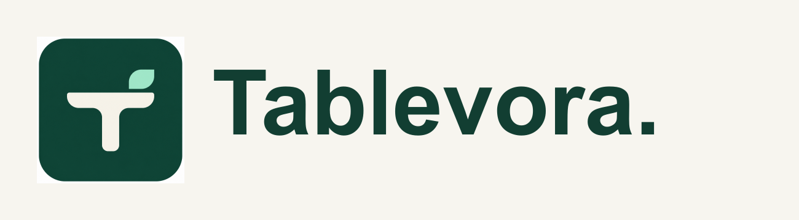

<div align="center">
  
  <p><strong>A calmer service. A smarter restaurant.</strong></p>
  <p>Restaurant POS, kitchen display, tables, billing, inventory, and reporting.</p>
</div>

Tablevora is a customized, self-hostable restaurant operations platform maintained by **Faizan**. It builds on [Nodedr OrderRestro](https://github.com/Raktim94/nodedr-restaurant-pos) by Nodedr Infotech Private Limited and Raktim Ranjit. It is distributed under **AGPL-3.0-only**, with original attribution preserved. See [NOTICE](NOTICE) and [LICENSE](LICENSE).

## What you can do

- Take dine-in, takeaway, and delivery orders, with modifiers and kitchen tickets.
- Track tables and kitchen preparation, accept orders, and manage cancellations.
- Settle bills with multiple payment methods, partial payments, and receipts.
- Manage menus, stock, customers, reservations, staff, and reports.
- Run on a restaurant's LAN without internet, provided terminals can reach the local server.
- Customize and offer installation, training, managed hosting, and support services.

## Quick start

Use Node 22+ and pnpm. PostgreSQL is required. Internal package names are preserved for compatibility.

```sh
pnpm install --frozen-lockfile
cp apps/backend/.env.example apps/backend/.env
# Set a real DATABASE_URL and a unique random JWT_SECRET in the ignored .env.
pnpm --filter @nodedr-restaurant/types build
pnpm --filter @nodedr-restaurant/backend exec prisma generate
pnpm --filter @nodedr-restaurant/backend exec prisma migrate deploy
pnpm --filter @nodedr-restaurant/backend build
```

Start the API from `apps/backend` using `node --env-file=.env dist/src/main.js`. In another terminal, run `pnpm --filter web dev`. Configure `CORS_ORIGIN=http://localhost:3000` for the default Next.js development port.

For a **dedicated demo database only**, run `pnpm --filter @nodedr-restaurant/backend prisma:seed`. Production demo seeding requires `DEMO_MODE=true`. Demo credentials are `owner@demo.local` / `Password123!`. Never seed a real client database with these public credentials.

## Deployment

Hosted sample workspace: [Tablevora demo](https://tablevora.vercel.app/login). Use `owner@demo.local` / `Password123!` and fictional information only. The demo uses Vercel for the frontend, Render Free for the API, and Neon Free PostgreSQL provisioned through Vercel Marketplace. Free quotas and cold starts apply.

See [the deployment guide](docs/deployment.md) for Docker, Vercel frontend, and persistent API hosting. The shared demo disables administrative configuration, integrations, system operations, and hardware printing while retaining operational workflows. It uses sample data; do not enter real customer information.

For a real installation, keep `DEMO_MODE=false`, configure unique credentials, HTTPS, backups, and the correct local tax settings. Browser printing works remotely; direct USB/network printing needs a backend with access to the restaurant's devices.

## Quality checks

```sh
pnpm --filter @nodedr-restaurant/types build
pnpm --filter @nodedr-restaurant/backend exec prisma generate
pnpm --filter @nodedr-restaurant/backend build
pnpm --filter web build
pnpm test
pnpm audit
```

See [release notes](TABLEVORA-RELEASE.md) for the exact checks performed and remaining limitations. [The original issue report](ISSUES-REPORT.md) and [historical audit](SECURITY-AUDIT-REPORT.md) provide context, not a current guarantee of security.

See [the launch and client-service workflow](docs/LAUNCH-PLAN.md) for the portfolio, pilot, and commercial rollout.

## Service offering

Tablevora can be customized and deployed for restaurants and cafés. Services include menu setup, workflow changes, deployment, training, and maintenance. Software licensing rights remain under AGPL; service agreements cover the work and support provided.

[Source and issues](https://github.com/M-FaizanAli/tablevora) · [Brand guide](docs/brand/README.md) · [Architecture](ARCHITECTURE.md)
